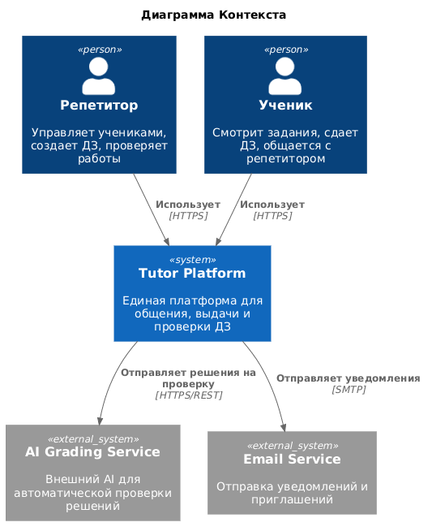
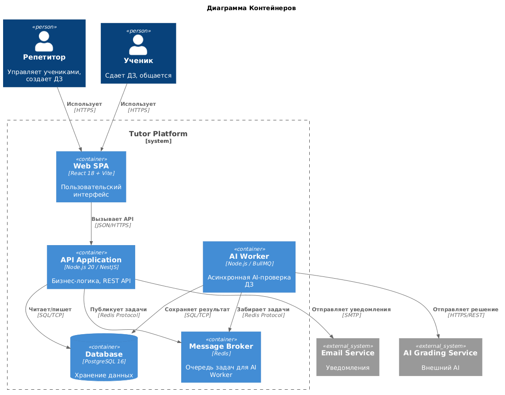
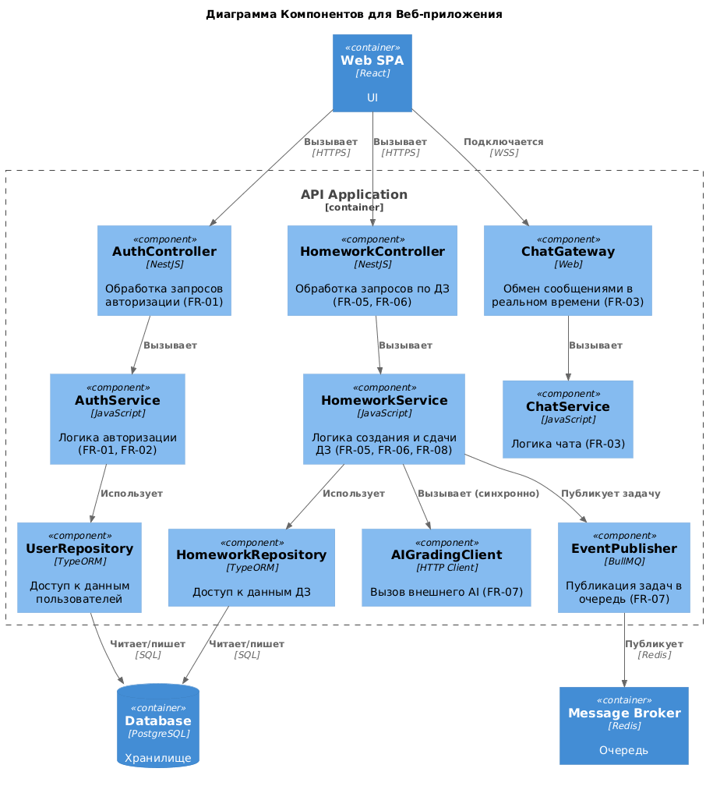
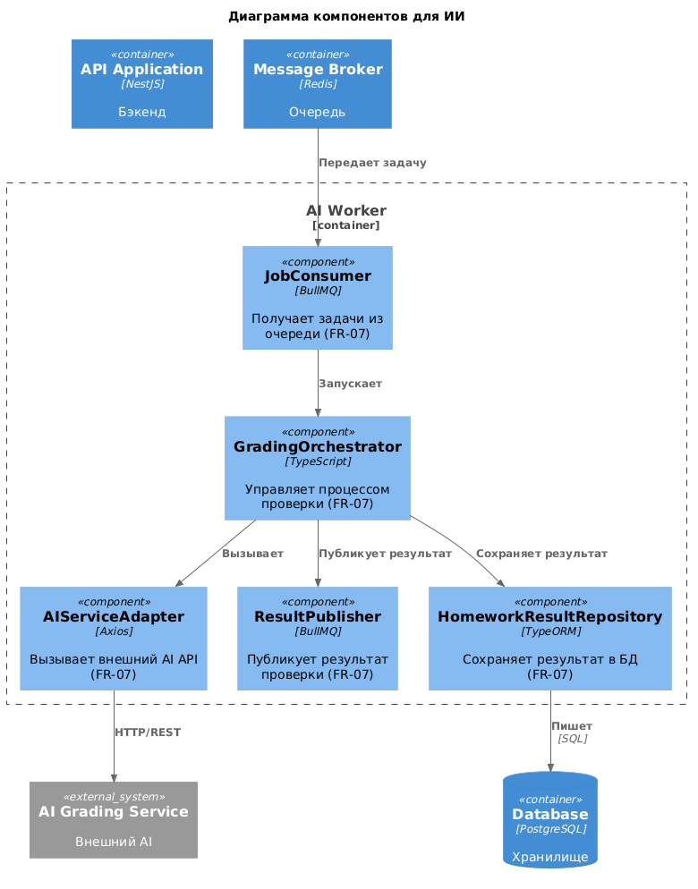

# Лабораторная работа №2. C4 model для проектирования архитектуры программной системы

## Титульный блок

| Поле | Значение |
|---|---|
| **Студент** | Гридусов Павел Лаврович |
| **Группа** | РИС-23-3 |
| **Вариант** | Тема ВКР (ИС для репетитора с ИИ-проверкой) |
| **Ссылка на ЛР №1** | https://github.com/cryez99/VKR_Tutor_Platform/tree/main/Lab1/docs |
| **Репозиторий** | https://github.com/cryez99/VKR_Tutor_Platform |
| **Инструмент диаграмм** | C4-PlantUML |

**Тема:** Использование нотации C4 model для проектирования архитектуры программной системы.

**Цель:** Получить опыт использования графической нотации для фиксации архитектурных решений.

---

## Краткое описание системы

Разрабатываемая система - это веб-платформа (EdTech), объединяющая репетитора и учеников. Она решает проблему разрозненности инструментов (мессенджеры, почта, бумажные тетради), предоставляя единое окно для коммуникации, обмена ссылками на видеозвонки, выдачи и сдачи домашних заданий. Главная инновация - интеграция ИИ для автоматической проверки решений учеников.

**Ключевые NFR из ЛР №1, влияющие на архитектуру:** 
- NFR-01 (Performance): быстрый отклик чата.
- NFR-02 (Security): защита данных (152-ФЗ, хеширование).
- NFR-04 (Scalability): выдерживать 100 одновременных запросов к AI.

---

## 1. Диаграмма системного контекста

На диаграмме показана проектируемая система (Tutor Platform) в центре, два типа пользователей (Репетитор и Ученик) и внешние системы, с которыми есть интеграция (AI Service для проверки ДЗ, Email Service для уведомлений).

### Диаграмма

### Описание элементов

| Элемент | Тип | Назначение |
|---|---|---|
| Репетитор | Person | Управляет учениками, создает ДЗ, общается, проверяет работы |
| Ученик | Person | Смотрит расписание, общается, сдает ДЗ, видит результаты |
| Tutor Platform | System | Единая платформа для обучения и проверки ДЗ |
| AI Grading Service | System_Ext | Внешний API (например, OpenAI) для проверки решений |
| Email Service | System_Ext | Отправка уведомлений и приглашений |

### Внешние интеграции

| Внешняя система | Протокол | Назначение |
|---|---|---|
| AI Grading Service | HTTPS/REST | Отправка решения на проверку и получение оценки |
| Email Service | SMTP | Отправка уведомлений о новых заданиях и результатах |

---

## 2. Диаграмма контейнеров

Система разбита на 3 контейнера: SPA (фронтенд), API (бэкенд) и Worker (фоновая обработка AI). Взаимодействие между SPA и API идет по HTTPS/REST, между API и Worker - через очередь сообщений (Redis/BullMQ). Данные хранятся в PostgreSQL.

### Диаграмма

### Описание контейнеров

| Контейнер | Тип | Технология | Назначение | Какие FR покрывает |
|---|---|---|---|---|
| Web SPA | Контейнер | React 18 + Vite | Пользовательский интерфейс для репетитора и ученика | FR-01, FR-03, FR-04, FR-05, FR-06, FR-09 |
| API Application | Контейнер | Node.js 20 / NestJS | Бизнес-логика, REST API, авторизация | FR-01, FR-02, FR-03, FR-04, FR-05, FR-06, FR-08, FR-09 |
| AI Worker | Контейнер | Node.js / BullMQ | Асинхронная отправка ДЗ в AI и получение результата | FR-07 |
| Database | База данных | PostgreSQL 16 | Хранение пользователей, заданий, решений, оценок | — |
| Message Broker | Контейнер | Redis | Очередь задач для AI Worker | — |

### Выбор архитектурного стиля

Выбран **событийно-ориентированный стиль (event-driven) с элементами слоистой архитектуры** для бэкенда. Это обусловлено требованием NFR-04 (Scalability): проверка ДЗ через внешнее AI API - длительная операция (может занимать секунды), и держать HTTP-запрос открытым все это время неэффективно. Выделение AI Worker в отдельный процесс и использование очереди (Redis/BullMQ) позволяет API мгновенно отвечать ученику («Задание принято»), а проверка происходит в фоне. Это также обеспечивает отказоустойчивость: если AI-сервис временно недоступен, задача остается в очереди и повторяется.

---

## 3. Диаграмма компонентов (контейнер API Application)

Выбран контейнер **API Application**, так как он содержит основную бизнес-логику и координирует работу всех остальных частей системы.

### Диаграмма

### Описание компонентов

| Компонент | Роль | Технология | Покрываемые FR |
|---|---|---|---|
| AuthController | Контроллер | NestJS Controller | FR-01 |
| HomeworkController | Контроллер | NestJS Controller | FR-05, FR-06 |
| ChatGateway | Контроллер | NestJS Gateway | FR-03 |
| AuthService | Сервис приложения | JS | FR-01, FR-02 |
| HomeworkService | Сервис приложения | JS | FR-05, FR-06, FR-08 |
| ChatService | Сервис приложения | JS | FR-03 |
| UserRepository | Репозиторий | TypeORM | FR-01, FR-02 |
| HomeworkRepository | Репозиторий | TypeORM | FR-05, FR-06, FR-08 |
| AIGradingClient | Интеграция | HTTP Client | FR-07 |
| EventPublisher | Интеграция | BullMQ | FR-07 |

---

## 4. Компоненты второго контейнера (AI Worker)

Контейнер **AI Worker** выбран для детализации, так как он реализует ключевую инновацию проекта — асинхронную проверку ДЗ через внешний AI-сервис.

### Диаграмма

### Описание компонентов

| Компонент | Роль | Технология | Покрываемые FR |
|---|---|---|---|
| JobConsumer | Просмотр событый | BullMQ | FR-07 |
| GradingOrchestrator | Сервис приложения | JS | FR-07 |
| AIServiceAdapter | Интеграция | HTTP Client | FR-07 |
| ResultPublisher | Публикователь сообщений | BullMQ | FR-07 |
| HomeworkResultRepository | Репозиторий | TypeORM | FR-07 |
